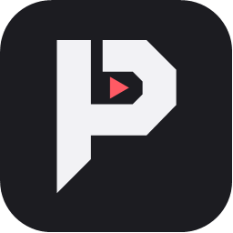
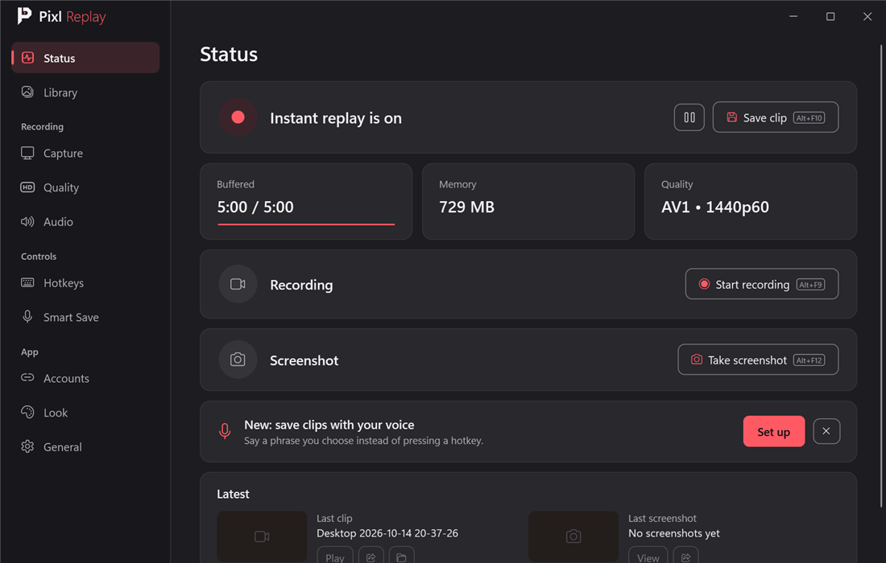
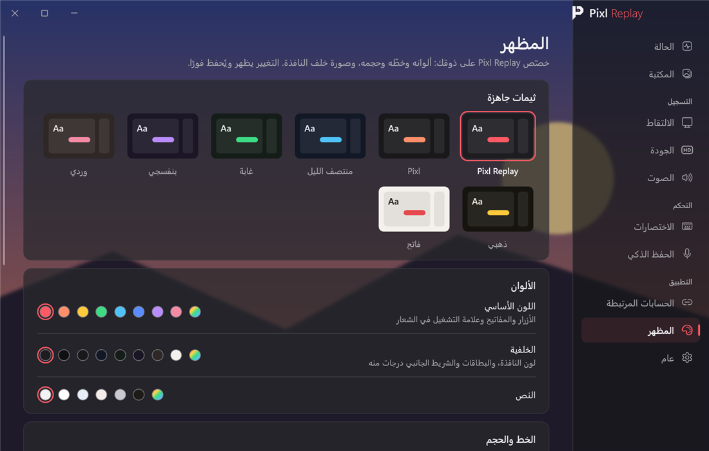
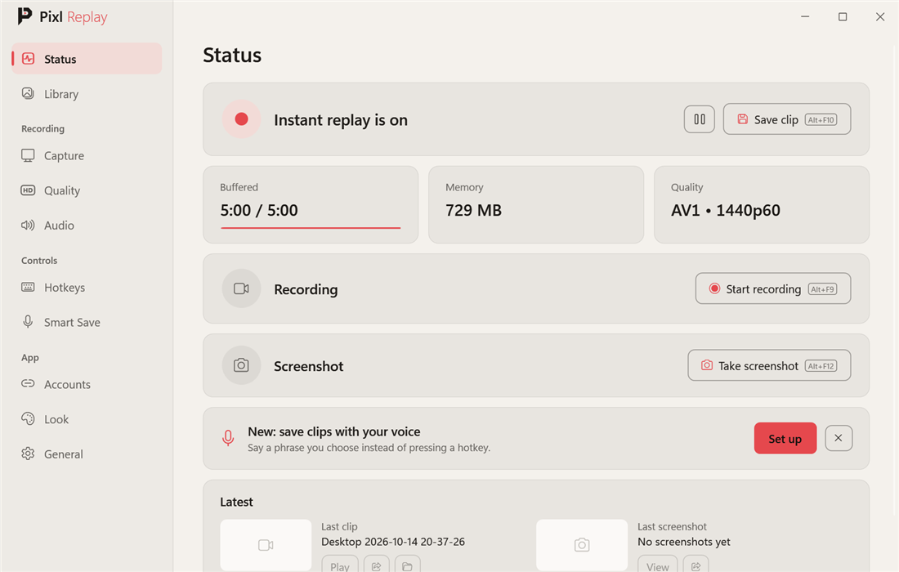

<p align="center">
  
</p>

<h1 align="center">Pixl Replay</h1>

<p align="center">
  Instant replay for Windows games, from the Pixl family.<br>
  Press a key or say your phrase, and the last minutes are saved.
</p>

<p align="center">
  <a href="https://github.com/9i55/PixlReplay/releases/latest"></a>
  
</p>

<p align="center">
  
</p>

<div dir="rtl">

## بالعربي

**Pixl Replay** يسجّل آخر دقائق من لعبك في الخلفية، ويوم يصير شي يستاهل تضغط `Alt+F10` (أو تقول جملتك) ويحفظه لك كمقطع.

### المميزات

- **الإعادة الفورية:** يحتفظ بآخر 15 ثانية إلى 20 دقيقة (5 دقائق افتراضيًا) ويحفظها بضغطة.
- **الحفظ الذكي:** سجّل جملة بصوتك، وقلها وقت اللعب عشان يحفظ المقطع أو ياخذ صورة. يشتغل بدون إنترنت.
- **خفيف:** يسجّل على كرت الشاشة (NVIDIA و AMD و Intel)، وما تحس فيه.
- **محرّر:** قص، سرعة، نصوص، رسم، تمويه، وترجمة تلقائية على جهازك.
- **مشاركة:** انشر على X و TikTok و Instagram، أو انسخ المقطع والصقه وين ما تبي.
- **المظهر (جديد):** صفحة كاملة تخصّص فيها البرنامج على ذوقك:
  - ثيمات جاهزة (Pixl Replay و Pixl ومنتصف الليل وغابة وبنفسجي ووردي وذهبي وفاتح)
  - تختار لون أساسي ولون خلفية ولون نص، من الألوان الجاهزة أو أي لون تبيه
  - تختار الخط (أي خط مثبّت في ويندوز، أو خطوط عربية جاهزة مثل Cairo و Tajawal)
  - تكبّر أو تصغّر كل النافذة (80% إلى 140%)
  - تحط صورة خلفية خلف النافذة، مع التعتيم والضبابية ووضوح البطاقات
  - زر يرجّع كل شي للافتراضي
  - التغيير يظهر ويُحفظ فورًا، وأيقونة البرنامج جنب الساعة تاخذ نفس اللون

### التحميل

1. نزّل **PixlReplay-Setup.exe** من [آخر إصدار](https://github.com/9i55/PixlReplay/releases/latest).
2. شغّله واختر اللغة والمجلد (ما يحتاج صلاحيات مسؤول).
3. العب، واضغط `Alt+F10` يوم يصير شي.

لو طلع لك تحذير من ويندوز: اضغط **More info** ثم **Run anyway**.
التحديثات تجيك من داخل البرنامج.

**يحتاج:** ويندوز 10 (2004 أو أحدث) أو ويندوز 11، 64-بت.

</div>

<p align="center">
  
</p>

## English

**Pixl Replay** keeps the last minutes of your game in memory. When something happens, press `Alt+F10` (or say your phrase) and it becomes a clip.

- **Instant replay:** keeps 15 seconds to 20 minutes (5 by default) and saves it in one press.
- **Smart Save:** record a phrase in your own voice and say it to save a clip or take a screenshot. Works offline.
- **Light:** records on your graphics card (NVIDIA, AMD or Intel).
- **Editor:** cut, speed, text, drawing, blur, and auto captions on your own PC.
- **Share:** post to X, TikTok and Instagram, or copy the clip and paste it anywhere.
- **Look (new):** make it yours.
  - Ready-made themes.
  - Your own accent, background and text colors.
  - Any installed font.
  - The whole window from 80% to 140%.
  - A background picture, with darken, blur and panel opacity.
  - Changes show and save at once, and the tray icon follows the colors.

<p align="center">
  
</p>

### Download

1. Download **PixlReplay-Setup.exe** from the [latest release](https://github.com/9i55/PixlReplay/releases/latest).
2. Run it, pick your language and folder (no administrator rights needed).
3. Play, then press `Alt+F10` when something happens.

**Needs:** Windows 10 (2004 or newer) or Windows 11, 64-bit.

### Build from source

Pixl Replay is a .NET 10 app (WPF and WinForms) that hosts **libobs**, the engine of [OBS Studio](https://obsproject.com), and uses FFmpeg for editing and sharing.

```powershell
dotnet build src\PixlReplay\PixlReplay.csproj -c Release
dotnet run --project tests\PixlReplay.Tests -c Release   # the tests
.\tools\make-icon.ps1                                     # app.ico and the installer pictures from the logo's drawing
.\tools\release.ps1                                       # the Setup, update files and source zip in releases\
```

The build copies libobs 32.2.2 from an installed OBS Studio.

## License

Pixl Replay is free software under the [GNU General Public License v2.0 or later](LICENSE). Every release includes its complete source code. Components and their licenses are listed in [THIRD-PARTY-NOTICES.md](THIRD-PARTY-NOTICES.md).

Made by **9i55**.
